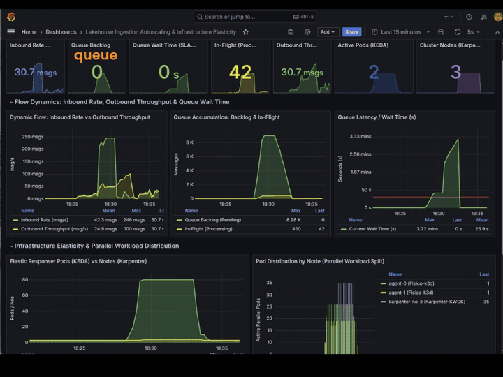

# Ingestion autoscaling lab

Zero-cost simulation of a cloud ingestion pipeline that reacts on its own to a daily load peak:
the SQS queue fills up, KEDA scales consumer pods out, Karpenter adds nodes when pods go `Pending`,
and everything scales back in once the backlog drains.

Everything runs on one VPS: LocalStack (S3 + SQS), k3d (Kubernetes), KEDA, Karpenter with the
KWOK provider (simulated nodes), Prometheus and Grafana. Data is synthetic TPC-H generated by DuckDB.
Design and decisions: [PLANO.md](PLANO.md).

[](media/scaling.mp4)

*Click the animation for the full-quality video.*

```
producer ──► SQS ingestion-queue ──► consumer pods (KEDA 2→40) ──► S3 scaling-refined
   │                                        │                        + SQS processed-events-queue
   └─ points to S3 scaling-raw (TPC-H)      └─ pods Pending ──► Karpenter adds KWOK nodes
```

## Layout

| Path | Content |
|---|---|
| `src/common.py` | env config, boto3 clients, `HOURLY_RATES` (the simulated day) |
| `src/generator.py` | TPC-H batches into `s3://scaling-raw/raw/orders/` |
| `src/producer.py` | claim-check messages into SQS (fixed rate, exact count or full day) |
| `src/consumer.py` | SQS → DuckDB aggregation → Parquet in `scaling-refined` |
| `src/exporter.py` | Prometheus metrics for the Grafana dashboard (queue + pods + nodes) |
| `src/experiment.py` | runs scenario A/B/C and writes `results/scenario_<name>.csv` |
| `docker/` | `Dockerfile` (one image for consumer and exporter), compose, Prometheus, Grafana |
| `k8s/` | consumer Deployment, KEDA ScaledObject, Karpenter NodePool, exporter RBAC |
| `terraform/` | buckets and queues (LocalStack endpoint; same code works on real AWS) |

## Prerequisites (on the VPS)

Docker, k3d, kubectl, helm, terraform and Python 3.12 with `pip install -r requirements.txt`
(the generator, producer and experiment run on the host). SSH alias `vpsmouts` configured locally.
Every `make` target runs from your machine and executes on the VPS over SSH.

## Build the Docker image and run the test

1. Start the base stack. This builds the image `scaling-app:latest` from `docker/Dockerfile` and
   starts LocalStack, the exporter, Prometheus and Grafana:

   ```bash
   make up
   ```

   To build the image alone:

   ```bash
   ssh vpsmouts "docker build -t scaling-app:latest -f /opt/scaling/docker/Dockerfile /opt/scaling"
   ```

2. Create the buckets and queues, then generate the raw data:

   ```bash
   make tf-init tf-apply
   make gen-data
   ```

3. Run the end-to-end test. It sends 100 msg/s for 5s, then runs the consumer in a container
   for 15s:

   ```bash
   make test-pipeline
   ```

   Expected consumer log: `[ENTRADA] Lote #...` and `[SAIDA] Lote #... refinado gravado` lines,
   then `Worker encerrado.`.

4. Open Grafana through the SSH tunnel at http://localhost:3001 (admin/admin):

   ```bash
   make tunnel
   ```

## Kubernetes autoscaling

```bash
make k8s-cluster      # k3d cluster on the LocalStack network
make k8s-keda         # KEDA
make k8s-karpenter    # Karpenter KWOK + NodePool (see note below)
make k8s-deploy       # builds scaling-app:latest, imports it into k3d, applies consumer + KEDA
make k8s-token        # read-only token for the exporter (pods and nodes panels)
make k8s-status
```

Quick checks:

```bash
make test-autoscaling MSGS=2000 RATE=250   # pods scale out
make test-node-autoscaling                  # nodes scale out (Karpenter NodeClaims)
make watch-scaling                          # live pods, HPA and nodes
make karpenter-logs
```

**Karpenter KWOK note:** there is no published image for the KWOK provider. `make k8s-karpenter`
expects the image `karpenter-kwok:latest` already imported into k3d and the chart at
`/tmp/karpenter-repo/kwok/charts` (clone of `kubernetes-sigs/karpenter` at `v1.15.0`). The KWOK
controller itself (`kwok-controller` in `kube-system`) is also installed manually from that repo.
`/tmp` does not survive a reboot: override with `make k8s-karpenter KARPENTER_REPO=<path>`.

## Experiment: same day, three scenarios

```bash
make dia-fixo      # A: fixed fleet, 2 pods
make dia-keda      # B: KEDA 2→40 pods + Karpenter
make dia-grande    # C: fixed fleet, 40 pods
make fetch-results # copies results/*.csv to your machine
```

`SEC_PER_HOUR=5` by default (one simulated day = 2 min). Run all three with the same value so the
CSVs are comparable.

## Limits

Emulators validate architecture, IaC and autoscaling behaviour, not real cloud latency or throughput.
Node scaling is simulated (KWOK): Karpenter's decisions are real, the machines are not.
Absolute throughput reflects the VPS.
